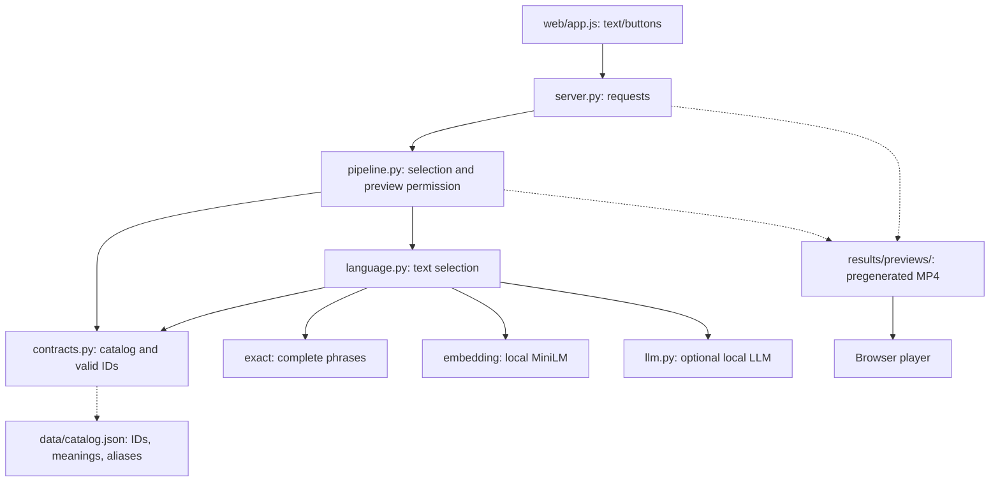
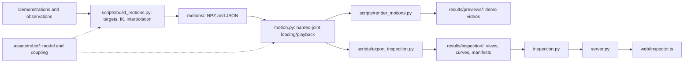
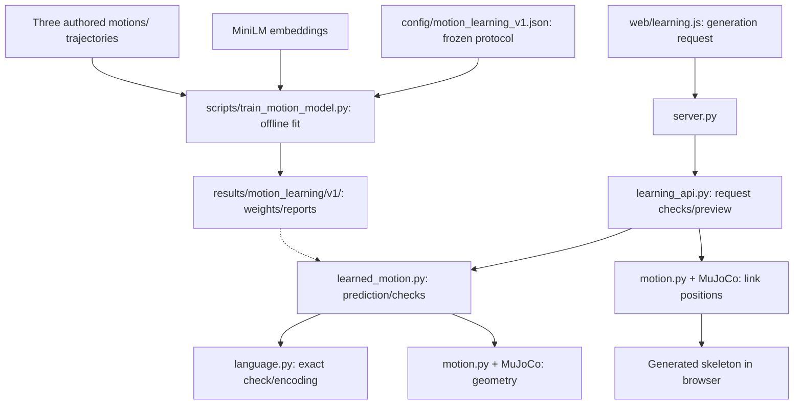

# ME5412 code dependencies and adding expressions

[中文](code-dependencies.md) · **English** · [Documentation index](README.md)

Reviewed at `kimzclandi/me5412-sign-robot` commit `3da7d842f09d8dffe812d436a619679335c88f76`; no model/simulation rerun. The website already shows the business workflow. This explains calls and artifact dependencies.

## 1. Ordinary interactive demo

Solid arrows are calls/requests; dashed arrows are file reads.

`language.py` returns an ID/rejection; `pipeline.py` checks result/permission and video existence before returning its URL; the browser requests video from `server.py`. Buttons bypass text matching and send IDs to preview.

Ordinary requests do not read NPZ, run IK, or generate motion live. Production must keep rendered videos and versioned NPZs consistent.

## 2. Motion construction and inspection

Solid arrows mean artifact dependencies; dashed arrows mean shared resources.

Construct trajectories before rendering. Motions can be authored separately, but `build_motions.py` currently defines all three in one script and writes fixed paths. Before parallel work, separate shared tools from motion definitions and use independent experiment directories.

## 3. Learning route

Separate training/generation entries exist. v1 binds three demonstrations; a catalog entry does not automatically extend the model.

Inference reads weights, not demonstration NPZs. `learning_api.py` and training use fixed v1 paths; metadata records three durations. New learned motions need a new version, data, and training. Library extension can precede this.

## 4. Locations affected by a new expression

| Location | Purpose | Check when extending |
|---|---|---|
| `data/catalog.json` | Runtime catalog | ID, meaning, aliases, sources/status. |
| `contracts/interfaces.json` | Contract documentation | Fixed-three ID list must update. |
| `src/sign_robot/motion.py` | Loading/playback | Fixed-three `ACTION_IDS`; organize registration. |
| `scripts/build_motions.py` | Construction | Definitions, shared IK, new output paths. |
| `motions/` | Trajectories | Same-name NPZ/JSON; names align with columns. |
| `scripts/render_motions.py` | Preview | `ACTION_IDS` and fixed screenshot times; changing only IDs may still fail. |
| Export/inspection modules | Inspection | New IDs and newly exported artifacts. |
| `language.py` | Selection | Dynamic catalog already used; shared guards may block new expressions. |
| `web/app.js` | Buttons | Dynamic catalog supplies most new buttons. |
| `project_overview.py`, `web/project.js` | Overview/counts/materials | Some descriptions/registrations bind three motions. |
| `website/dist/` | Static shareable display | Separate export and republishing required. |
| Learning v1 | Experimental generation | Does not extend with the catalog. |

`motion.py` is shared robot infrastructure; `contracts.py`/catalog are shared selection dependencies. Communicate changed conventions before edits.

## 5. Avoid unnecessary waiting

Use the [current three-pair guide](ten-intent-learning-guide.en.md); no named teammates are assigned.

- First agree on ten intent IDs, joint order, units, timing, and one example motion.
- Pair 1 implements the keyword baseline and MiniLM selector in parallel and jointly evaluates paraphrases/rejection.
- Pair 2 extracts/cleans hand-arm demonstrations and maps robot trajectories, jointly checking meaning preservation.
- Pair 3 divides primary ownership between conditional training and inference/execution/transitions/smoothing; both train/debug and compare against direct playback.
- UI, report, slides, integration, and reproduction are shared. Independent tests are cross-run by teammates who did not tune the corresponding component.

Selection can use the agreed catalog, and learning plumbing can use explicitly labeled example motion. Valid training still depends on pair 2's data, and the full demo depends on aligned interfaces/versions across all pairs. Parallel work does not remove those dependencies. Static export/publication remains separate.

## Source entries

- [server.py](https://github.com/kimzclandi/me5412-sign-robot/blob/3da7d842f09d8dffe812d436a619679335c88f76/src/sign_robot/server.py)
- [pipeline.py](https://github.com/kimzclandi/me5412-sign-robot/blob/3da7d842f09d8dffe812d436a619679335c88f76/src/sign_robot/pipeline.py)
- [motion.py](https://github.com/kimzclandi/me5412-sign-robot/blob/3da7d842f09d8dffe812d436a619679335c88f76/src/sign_robot/motion.py)
- [render_motions.py](https://github.com/kimzclandi/me5412-sign-robot/blob/3da7d842f09d8dffe812d436a619679335c88f76/scripts/render_motions.py)
- [Static display](../website/README.en.md)
