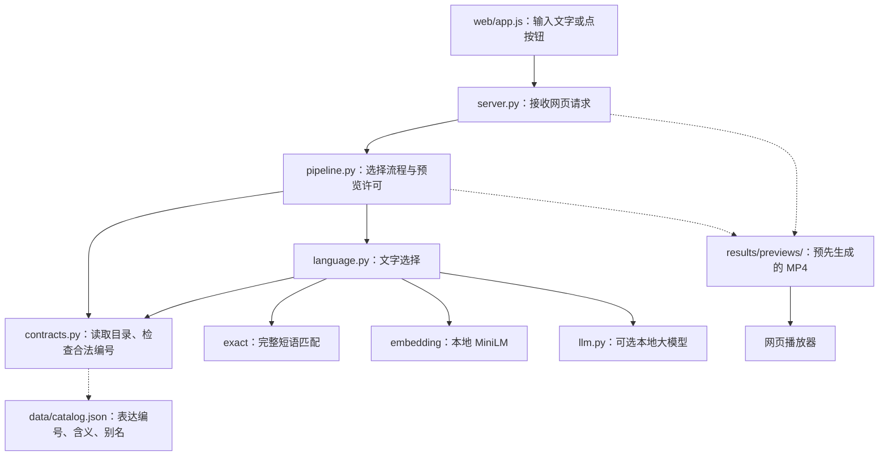
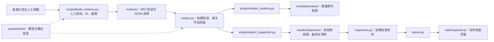
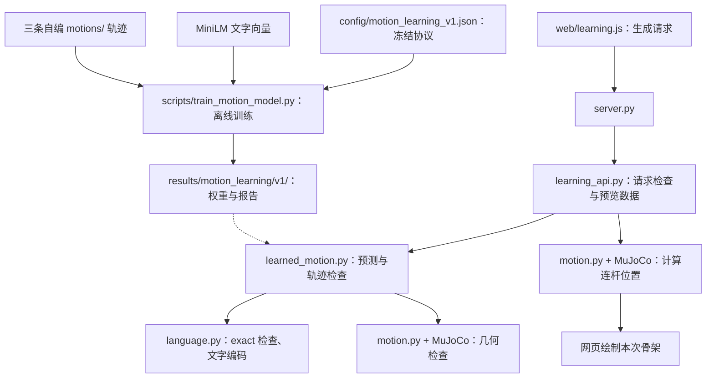

# ME5412 代码依赖与扩充动作说明

**中文** · [English](code-dependencies.en.md) · [说明目录](README.md)

依据仓库 `kimzclandi/me5412-sign-robot` 的提交 `3da7d842f09d8dffe812d436a619679335c88f76` 整理。属于源码审阅，没有重新运行模型或仿真。网页“项目总览”已有业务流程展示；本文补充文件之间的调用和产物依赖。

## 1. 普通交互演示

实线表示调用或请求；虚线表示读取文件。

`language.py` 返回编号或拒绝状态；`pipeline.py` 检查结果和预览许可，确认视频文件存在后返回视频地址；浏览器再向 `server.py` 请求视频。按钮入口跳过文字匹配，直接把编号交给预览流程。

普通交互演示请求不会现场读取 NPZ、运行 IK 或生成机器人动作。已渲染视频与新版 NPZ 必须由制作流程保持一致。

## 2. 动作制作与动作检查

箭头表示下一步需要前一步的输出；虚线表示公共资源依赖。

制作人员先产生轨迹，再渲染。两个动作可以分别制作，但目前 `build_motions.py` 把三条动作放在同一脚本里，而且导出到固定路径；并行开发前应拆出共同工具和各动作定义，并为新实验使用独立输出目录。

## 3. 学习模型路线

该路线有独立训练与生成入口。当前 v1 绑定三条示范，新增动作库条目不会自动加入模型。

当前推理读取训练权重，不读取原始示范 NPZ。`learning_api.py` 和训练脚本使用固定 v1 路径，元数据记录三条动作的时长；要新增学习动作，需要设计独立新版本、补数据并训练。普通动作库扩充可以先完成。

## 4. 新增表达会影响哪些位置

| 位置 | 作用 | 扩充时的检查 |
|---|---|---|
| `data/catalog.json` | 运行时表达目录 | 新增合法编号、含义、别名、来源与状态 |
| `contracts/interfaces.json` | 接口说明 | 其中编号列表固定为三个，需要同步说明 |
| `src/sign_robot/motion.py` | 动作加载与回放 | `ACTION_IDS` 固定为三个，需要整理注册方式 |
| `scripts/build_motions.py` | 制作轨迹 | 新动作定义、共用 IK 工具、独立输出目录 |
| `motions/` | 实际轨迹 | 同名 NPZ 与 JSON；关节名和数组列一致 |
| `scripts/render_motions.py` | 渲染普通预览 | 导入 `ACTION_IDS`，截图时间字典也固定为三个；只改编号仍可能报错 |
| `scripts/export_inspection.py`、`inspection.py` | 动作检查资料 | 依赖 `ACTION_IDS`，新动作还须导出检查资料 |
| `src/sign_robot/language.py` | 文字匹配 | 匹配目录已动态读取；公共拒绝规则可能挡住新增表达，需要核对 |
| `web/app.js` | 普通网页入口 | 短语按钮从目录动态生成；大多数新增按钮无需手工添加 |
| `project_overview.py`、`web/project.js` | 总览、数量和资料展示 | 部分文字、材料登记绑定当前三条动作，完成后需要同步 |
| `website/dist/` | 公开静态展示 | 与本地实验台分开；本地扩充后需要更新导出内容和重新发布 |
| 学习模型 v1 | 独立轨迹生成实验 | 不随动作目录自动扩充 |

`motion.py` 是机器人相关公共模块；`contracts.py` 和表达目录是选择相关公共依赖。修改这些位置的人要先告知其他成员新约定。

## 5. 六人怎样避免互相等待

当前按[三组两人指南](ten-intent-learning-guide.md)分工，尚未绑定具体同学。

- 三组先约定十个意图 ID、关节顺序、单位、时间格式与一条示例动作。
- 第一组并行实现关键词基线与 MiniLM 语义选择，共同评估改写和拒绝。
- 第二组分别提取清洗手臂示范、映射机器人轨迹，共同检查表达含义是否保留。
- 第三组分别主责条件训练、推理执行与衔接平滑；两人共同训练调试并做直接回放对照。
- UI、报告、PPT、联调和复现由全组共同承担；独立测试由未参与对应调参的同学交叉执行。

文字组可使用已约定目录，学习组可用明确标记的示例动作先搭流程。有效训练仍依赖第二组的数据，完整演示依赖三组接口和版本对齐；并行不能消除这些依赖。静态导出与公开发布仍是单独步骤。

## 源码入口

- [请求入口 server.py](https://github.com/kimzclandi/me5412-sign-robot/blob/3da7d842f09d8dffe812d436a619679335c88f76/src/sign_robot/server.py)
- [流程 pipeline.py](https://github.com/kimzclandi/me5412-sign-robot/blob/3da7d842f09d8dffe812d436a619679335c88f76/src/sign_robot/pipeline.py)
- [动作加载 motion.py](https://github.com/kimzclandi/me5412-sign-robot/blob/3da7d842f09d8dffe812d436a619679335c88f76/src/sign_robot/motion.py)
- [渲染 render_motions.py](https://github.com/kimzclandi/me5412-sign-robot/blob/3da7d842f09d8dffe812d436a619679335c88f76/scripts/render_motions.py)
- [静态展示说明](https://github.com/kimzclandi/me5412-sign-robot/blob/3da7d842f09d8dffe812d436a619679335c88f76/website/README.md)

