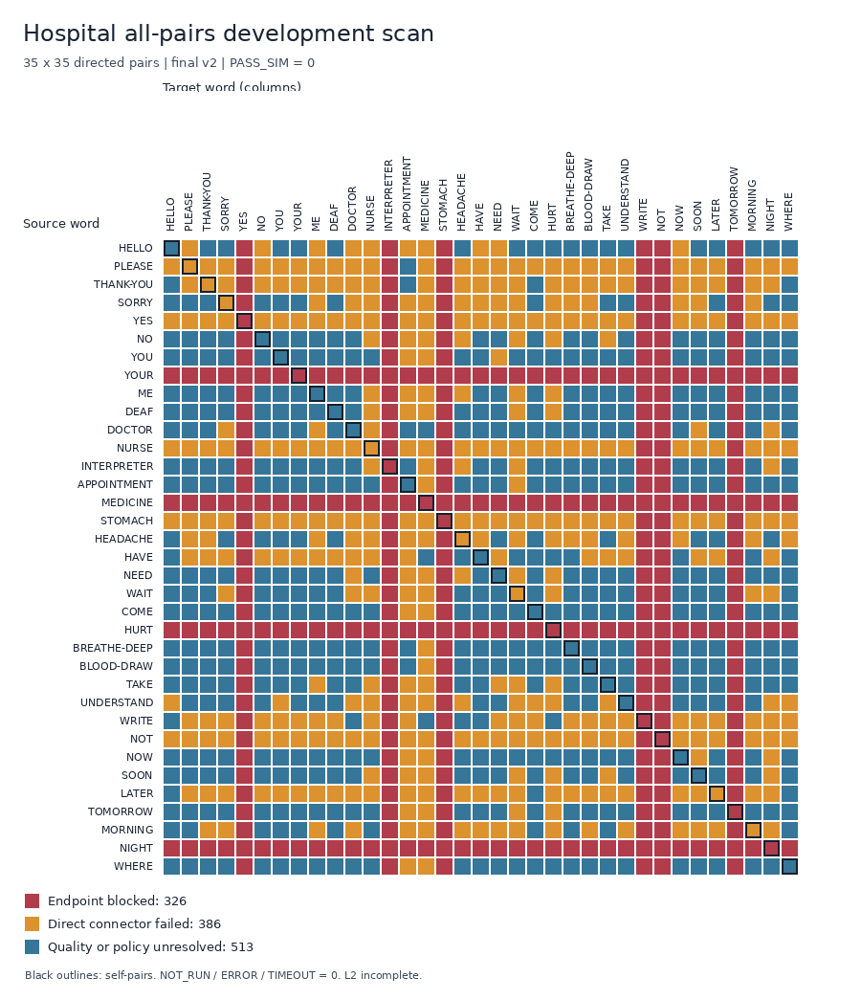

# Group 3 all-pairs transitions: October 31, 2026 implementation results

[中文](group3-all-pairs-progress.md) · [Running instructions](group3-all-pairs-startup.en.md) · [Original plan](group3-all-pairs-transition-plan.en.md)

This pass completes **L1 development-baseline coverage and diagnostics**. All 1,225 ordered pairs have unique statuses, all 899 saved candidates were re-read, and all 1,225 records were independently checked. **L2 remains incomplete**; this contract cannot emit PASS_SIM. No subagents were used.

Work is in `/home/kingderman/Documents/ME5412-github-latest`, on `codex/group3-all-pairs-v1`. No commit, push or publication was made. Pre-existing plan documents and index edits were preserved.

## Actual matrix

Final run: `all_pairs_dev_20261031_v2`. The all/non-self/self denominators remain 1,225/1,190/35.

| Main status | All | Non-self | Self |
|---|---:|---:|---:|
| BLOCKED_ENDPOINT | 326 | 316 | 10 |
| FAILED_SEARCH | 386 | 378 | 8 |
| FAILED_QUALITY | 513 | 496 | 17 |
| PASS_SIM | 0 | 0 | 0 |
| NOT_RUN | 0 | 0 | 0 |
| TIMEOUT | 0 | 0 | 0 |
| ERROR | 0 | 0 | 0 |
| BLOCKED_INPUT | 0 | 0 | 0 |
| SOURCE_NEAR | 0 | 0 | 0 |

FAILED_SEARCH means this single direct candidate failed dense checking; it does not prove that no path exists. FAILED_QUALITY includes original-slice defects and unresolved core/window/quality policy. Reason codes overlap and must not be added as mutually exclusive outcomes.

Playback-sample clearance accepted 524 direct connectors; dense checking reduced that number to 513, finding **11 additional failures**. The two counterexamples in the 40-pair sample were DOCTOR→NURSE (−25.851034 mm) and NOW→SOON (−0.253413 mm). Planning and verification keep separate statuses, clearances and closest-pair evidence; verification does not overwrite the original planning evidence.

Only **12 complete two-word previews** passed the implemented numerical checks. Pending policy and semantic review still prevent PASS_SIM. Every candidate retains `playback_eligible=false`. Connector checks and full-preview checks including initial rise/final return are reported separately.

Colors show exclusive main statuses; black diagonal outlines mark the 35 self-pairs.

## Engineering completed

- T00: froze 35 words, 1,225 pairs, 53 named coordinates, 12 coupling rules, motion/metadata/model/environment/source hashes and baseline research limits.
- T01: reused an existing environment matching the numerical dependencies, restored 11 pinned MiniLM files locally, and passed all 75 resource checks. Eight already-allowlisted documentation hashes were explicitly refreshed; historical frozen SOURCES were unchanged.
- T02 engineering audit: all 35 words have format, timing, limits, coupling, endpoints, derivatives and original-motion defect records. Semantic cores and allowed windows await Group 2 approval.
- T04: implemented ordered-pair running, atomic checkpoints, version-change refusal, resume and fixed-denominator matrix summaries.
- Basic T06: re-read every candidate and original input, checked both word occurrences, boundaries, time/hash/limits/coupling/rates, and sampled the declared curve at 1×/2×/4× resolution. Finite-difference acceleration/jerk and boundary jumps are reported separately.

This does not complete general IK/RRT, T03 quality freezing, T08 multiword assembly or T10 new-environment acceptance. Merely changing review strings cannot bypass the missing approved-core contract.

## Endpoint and original-motion defects

Four invalid departure endpoints and six invalid arrival endpoints affect **326 unique directed pairs**: 140 outgoing and 210 incoming edges overlap in 24 pairs. Records name the source/target side explicitly.

| Word | Role | Original frame | Minimum clearance mm |
|---|---|---:|---:|
| HURT | source | 70 | -13.417172 |
| INTERPRETER | target | 24 | -26.744698 |
| MEDICINE | source | 74 | 1.963783 |
| NIGHT | source | 64 | 0.424539 |
| NOT | target | 24 | -16.156179 |
| STOMACH | target | 24 | -17.206276 |
| TOMORROW | target | 24 | -30.864839 |
| WRITE | target | 24 | -24.888589 |
| YES | target | 24 | -41.437488 |
| YOUR | source | 91 | -7.838878 |

MEDICINE and NIGHT have positive gaps below the +2 mm research threshold. At current sampling, 30 original words have below-threshold frames and eight exceed this rate baseline; original limit/coupling errors are zero. These defects are separate. Motion assets and collision-pair exclusions were not changed to improve results.

NURSE f80/f81 comparisons bind the current motion SHA. f80 trims `8/79 = 10.126582%` and stays pending; f81 measures −28.426881 mm. New scanning keeps the original sign end and selects no historical trim. Human language and hardware reviews remain incomplete.

## Actual validation and cost

Before restoration, the suite had 535 passed and six failed. After environment/material registration repairs, **589 tests passed**, including 48 new tests. The original 248 focused tests remain passing.

The actual fixed ten-sentence R13c baseline was also rerun: **19/19 transitions PASS under its legacy rules**, and all ten saved sentences passed the existing artifact verifier. Those results use historical endpoint overrides, retain pending NURSE f80 approval, and cannot be imported as new-contract PASS_SIM or full-word/language acceptance.

The 40-pair planning command took 8.88 seconds and saved 30 candidates; sample verification took 98.02 seconds. Final full planning took **37.83 seconds**, independent verification **248.02 seconds**, and verification peak RSS was approximately **761.3 MiB**. The 899 NPZ files total 31,065,410 bytes. These timings describe this machine's single direct-candidate baseline, not future general RRT cost.

Resuming the completed run preserved all 1,225 checkpoint, 899 trajectory and 1,225 verification hashes. A separate run recomputed HELLO→PLEASE, NOW→NURSE, YOU→YOU and APPOINTMENT→BLOOD-DRAW: all four canonical numerical hashes matched. This observation covers the same environment and current direct method, not cross-environment byte identity.

## Evidence and next work

- [Final report](../results/group3_all_pairs_startup/final_report.json), [matrix CSV](../results/group3_all_pairs_startup/all_pairs_v2_matrix.csv), [denominators/reasons](../results/group3_all_pairs_startup/all_pairs_v2_summary.json).
- [Endpoint blockers](../results/group3_all_pairs_startup/endpoint_blockers.json), [additional dense failures](../results/group3_all_pairs_startup/dense_additional_failures.json), [quality development metrics](../results/group3_all_pairs_startup/quality_development_metrics.json).
- [Actual test log](../results/group3_all_pairs_startup/final_pytest.txt), [resource checks](../results/group3_all_pairs_startup/asset_verification.json), [resume integrity](../results/group3_all_pairs_startup/resume_integrity.json), [numerical reproduction](../results/group3_all_pairs_startup/reproducibility.json).

Complete trajectories, checkpoints, verification reports and 22 source snapshots live in ignored `results/all_pairs/all_pairs_dev_20261031_v2/`. Root `library_manifest.json` and `word_audit.json` match the run's frozen copies byte-for-byte. The source content hash is `2018f4a92c71f96a40fa0401847a65228cc391f0789d35766c23e039d4ff87d8`; the run manifest holds the full identity and inventory. Local files are not a remote backup or a receiver-accessible delivery package.

Next coordinate Group 2 endpoint/original-motion repairs and core/window approval. Freeze T03 derivative/jerk/duration/sampling policy from development evidence, then implement T05 general IK, finger policies and bounded search. Continue with T07 fixes, T08 multiword/repetition integration, T09 human/video comparisons and T10 new-environment delivery. Final collision-filter review, adaptive subdivision, continuous collision proof, language review and hardware validation remain incomplete.
