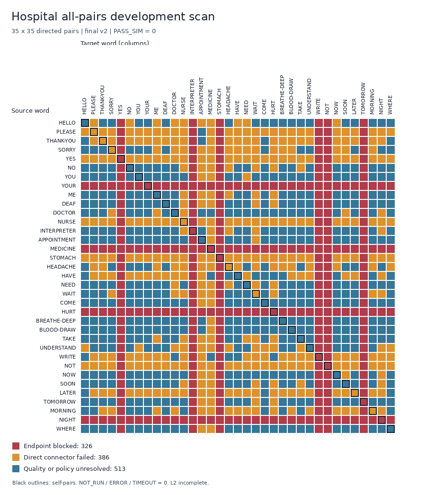

# 第三组全词对衔接：2026-10-31 实施结果

[English](group3-all-pairs-progress.en.md) · [运行说明](group3-all-pairs-startup.md) · [原规划书](group3-all-pairs-transition-plan.md)

本轮完成了 **L1 开发基线覆盖与诊断**：35 词的 1,225 个有向词对全部有唯一状态，899 条候选已保存并读取复核，全部 1,225 条记录都完成独立复核。**尚未完成 L2**；当前版本不产生 PASS_SIM。全程未调用 subagent。

工作保存在 `/home/kingderman/Documents/ME5412-github-latest`，分支 `codex/group3-all-pairs-v1`。本轮未提交、推送或发布。保留了进入本轮前已有的规划书及目录改动。

## 实际矩阵

最终运行编号：`all_pairs_dev_20261031_v2`。全部、异词、同词的分母始终分别为 1,225、1,190、35。

| 主状态 | 全部 | 异词 | 同词 |
|---|---:|---:|---:|
| BLOCKED_ENDPOINT | 326 | 316 | 10 |
| FAILED_SEARCH | 386 | 378 | 8 |
| FAILED_QUALITY | 513 | 496 | 17 |
| PASS_SIM | 0 | 0 | 0 |
| NOT_RUN | 0 | 0 | 0 |
| TIMEOUT | 0 | 0 | 0 |
| ERROR | 0 | 0 | 0 |
| BLOCKED_INPUT | 0 | 0 | 0 |
| SOURCE_NEAR | 0 | 0 | 0 |

`FAILED_SEARCH` 仅表示这一个直接候选经加密检查不合格，不能证明不存在路径。`FAILED_QUALITY` 包含原词片段缺陷和未冻结的核心/窗口/质量政策。原因码允许重叠，不能相加当作互斥计数。

播放帧检查的直接连接间隙合格数为 524；加密后为 513，额外发现 **11 对**不合格连接。40 对开发样本中的两个反例是 DOCTOR→NURSE（−25.851034 mm）和 NOW→SOON（−0.253413 mm）。规划阶段和独立复核阶段的状态、间隙、最差碰撞对分别保存，复核不会覆盖原始规划证据。

仅 **12 条完整两词预览**通过已执行的数值检查，它们仍受未冻结政策与语义审核限制，不能计为 PASS_SIM。候选全部保持 `playback_eligible=false`。连接检查与包含起势/收势的完整预览检查分开报告。

颜色表示互斥主状态；黑框对角线是 35 个同词重复。

## 完成的工程工作

- T00：冻结 35 词、1,225 对、53 个关节、12 条耦合关系、动作/元数据/模型/环境/源码哈希及基础研究门槛。
- T01：复用已有匹配数值依赖的 Python 环境；从本地副本恢复 11 个固定 SHA 的 MiniLM 文件；75 项资源哈希核对全部通过。显式更新既有下载白名单中 8 个说明文档哈希，冻结历史证据 SOURCES 未改变。
- T02 工程初审：35 词的格式、时间、限位、耦合、端点、边界导数与原词缺陷均有记录。语义核心和允许窗口仍待第二组确认。
- T04：实现全词对运行器、原子检查点、版本变化拒绝、续跑和分母固定的矩阵汇总。
- 基础 T06：重新读取全部候选和原词文件，检查两次动作、边界、时间、哈希、限位、耦合、速度以及实际曲线的 1×/2×/4× 加密几何；另报差分加速度、jerk 和边界跳变。

这不是通用 IK/RRT、T03 正式质量冻结、T08 多词组合或 T10 新环境验收的完成声明。仅修改政策中的审核字符串也不能绕过尚未实现的批准核心合同。

## 端点与原词问题

4 个离开端点和 6 个进入端点共同影响 **326 个有向词对**；140 条出边与 210 条入边有 24 对重叠。每条记录都标明 source/target。

| 词 | 端点角色 | 原动作帧 | 最小间隙 mm |
|---|---|---:|---:|
| HURT | source | 70 | -13.417172 |
| INTERPRETER | target | 24 | -26.744698 |
| MEDICINE | source | 74 | 1.963783 |
| NIGHT | source | 64 | 0.424539 |
| NOT | target | 24 | -16.156179 |
| STOMACH | target | 24 | -17.206276 |
| TOMORROW | target | 24 | -30.864839 |
| WRITE | target | 24 | -24.888589 |
| YES | target | 24 | -41.437488 |
| YOUR | source | 91 | -7.838878 |

MEDICINE 和 NIGHT 虽为正间隙，仍未达到 +2 mm 研究门槛。当前采样中，30 个原词存在低于门槛的帧，8 个原词超过本版速率基线；原词限位与耦合误差为零。这些缺陷独立登记，没有通过改动动作或删除碰撞对提高成绩。

NURSE f80、f81 都按当前动作 SHA 保存对照。f80 裁剪 `8/79 = 10.126582%`，保持 pending；f81 端点间隙为 −28.426881 mm。新扫描使用原始 sign end，不自动采用任何旧裁剪。人工语言与硬件审核均未完成。

## 实际验证和成本

环境恢复前，全仓为 535 passed、6 failed；恢复并修复资料登记后为 **589 passed**，含新增 48 项测试；原专项 248 项保持通过。

另实际重跑 R13c 的固定十句：旧规则下 **19/19 段 PASS**，十个保存句子均由原有复核函数读取通过。该结果使用历史端点覆盖，NURSE f80 仍待确认，不能导入为新合同的 PASS_SIM，也不代表完整词动作或语言评审通过。

40 对规划命令耗时 8.88 秒，保存 30 条候选；样本复核 98.02 秒。最终 v2 全量规划耗时 **37.83 秒**，独立复核 **248.02 秒**，复核峰值 RSS 约 **761.3 MiB**。899 条 NPZ 合计 31,065,410 字节。这只是单候选直接基线的本机成本，不能外推为通用 RRT 的成本。

完成后再次续跑，1,225 个检查点、899 条 NPZ 和 1,225 份复核文件的 SHA 全部保持不变；另起运行重算 HELLO→PLEASE、NOW→NURSE、YOU→YOU、APPOINTMENT→BLOOD-DRAW，4 对规范化数组哈希均一致。该观测只覆盖同环境、当前直接方法，不承诺跨环境逐字节一致。

## 证据与后续

- [最终汇总](../results/group3_all_pairs_startup/final_report.json)、[状态矩阵 CSV](../results/group3_all_pairs_startup/all_pairs_v2_matrix.csv)、[分母与原因统计](../results/group3_all_pairs_startup/all_pairs_v2_summary.json)。
- [端点阻塞清单](../results/group3_all_pairs_startup/endpoint_blockers.json)、[加密新增反例](../results/group3_all_pairs_startup/dense_additional_failures.json)、[质量开发指标](../results/group3_all_pairs_startup/quality_development_metrics.json)。
- [实际测试日志](../results/group3_all_pairs_startup/final_pytest.txt)、[资源核对](../results/group3_all_pairs_startup/asset_verification.json)、[续跑核对](../results/group3_all_pairs_startup/resume_integrity.json)、[数值复现](../results/group3_all_pairs_startup/reproducibility.json)。

完整轨迹、检查点、复核文件和 22 份源码快照保存在 `results/all_pairs/all_pairs_dev_20261031_v2/`，目录被 Git 忽略；根目录 `library_manifest.json`、`word_audit.json` 与本轮冻结副本逐字节一致。源码内容哈希为 `2018f4a92c71f96a40fa0401847a65228cc391f0789d35766c23e039d4ff87d8`，完整身份和文件校验清单在运行 manifest 中。本机文件不是跨机器备份或接收人可取得的交付包。

下一步先协调第二组修复上述端点及原词缺陷，确认语义核心/窗口；随后根据开发集冻结 T03 导数、jerk、时长和采样政策，推进 T05 通用 IK/手指策略/有界搜索。之后再做 T07 修复闭环、T08 多词与重复词整合、T09 人工/视频对照及 T10 新环境交付。碰撞过滤最终审核、自适应采样、连续碰撞证明、语言与硬件验证仍未完成。
