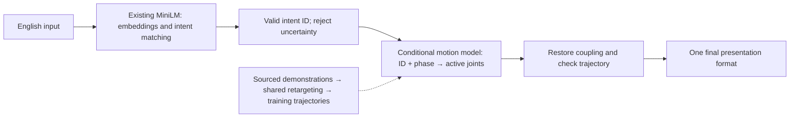

# ME5412: Six-person guide for ten intents and ten learned motions

[中文](ten-intent-learning-guide.md) · **English** · [Documentation index](README.md)

The next-stage goal is English input → one of ten fixed intents selected with an existing free model → robot trajectory generated by our trained motion model. Teams develop in parallel on task branches, then choose one primary presentation format, such as a local demo, website, or video. Online site rebuilding is deferred. The deadline is 2026-11-03. This is a plan, not completed work. Choose the ten meanings according to available demonstrations.

## 1. Shared system structure

Intent IDs are the ten shared meaning identifiers, using the existing `action_id` field. Paraphrases with the same meaning use the same motion condition; gratitude paraphrases enter `THANK_YOU`. Motion generation no longer varies with the original sentence embedding.

Reuse `sentence-transformers/all-MiniLM-L6-v2` first. It produces embeddings; catalog descriptions, aliases, cosine similarity, and rejection thresholds implement ten-class selection. It is not already a trained ten-class classifier. Local use needs no paid inference API. Choose thresholds on new development data before independent testing.

Start motion learning with conditional primitives: intent ID, normalized phase, and bounded duration → active-joint trajectories. Adapt the existing RBF ridge approach from text conditioning to fixed ID conditioning. Independent evidence should determine whether a more complex model is useful. The current upper-body design has 26 active coordinates reconstructed to 53 including coupled joints. Changes in robot degrees of freedom require synchronized interfaces/checks.

Shared IK/retargeting can convert human demonstrations to robot targets across all intents, reducing expression-by-expression authored poses. A model cannot invent its own training demonstrations. Three authored trajectories provide an engineering starting point; new real motion supervision is still absent.

## 2. Six roles: two language, two motion, two integration/presentation

| Person | Responsibility | Inputs | Deliverable and acceptance |
|---|---|---|---|
| 1: intent/text data | Agree on ten meanings with motion team; organize English variants and confusing negatives | Sources and `data/catalog.json` | Ten-class catalog, development data, label disputes; clear meaning and unsupported scope per ID. |
| 2: free model/selection | Reuse MiniLM; improve matching/rejection | Person 1's catalog/examples | Shared selection API, model/config versions, development results; do not force unknown inputs into ten classes. |
| 3: motion data/robot mapping | Obtain usable demonstrations; unify coordinates/time; shared retargeting | Meanings, human poses/motions, robot | Sourced trajectories, manifests, geometry checks; separate measured poses from approximations. |
| 4: conditional motion learning | Train ID-conditioned model on person 3's data; reconstruct coupling/check outputs | Training data, frozen protocol, constraints | New weights, generation API, fit and independent evaluation; inference generates from weights. |
| 5: interfaces/integration/independent evaluation | Manage registration/versions, independent tests, end-to-end flow, second-machine reproduction | Frozen versions and dependencies | Runnable release, independent raw results, failures; separate selection from motion quality. |
| 6: presentation format/report | Integrate and inspect versions early; produce one primary presentation format after stabilization | Integrated versions and checked trajectories | Unified ten-expression display, matching model version, backup of the same demo, and report. |

Motion data/learning is heavier than reusing embeddings. Person 1 helps organize demonstrations/pairs after defining the catalog. Person 2 continues language testing/integration after stabilizing the API. Persons 5/6 participate from day one.

## 3. Freeze interfaces before separate iterations

Keep language outputs: `status`, `action_id`, `reason_code`, `method`, `latency_ms`. With `execute`, the ID must belong to the ten-class registry; `clarify`, `unsupported`, and `error` have null ID. Historical `execute` means selection only; robot presentation has a separate check gate.

Suggested new motion entry: `generate_for_action(action_id, duration_scale, model_version)`. It is proposed, not implemented. A validated ID drives outputs containing `timestamps_s[T]`, `joint_names[J]`, `positions[T,J]`, model version, metrics, and acceptance. Joint angles are radians.

Fix this existing integration issue: v1 `learned_motion.generate(text)` performs exact matching again. A paraphrase accepted by MiniLM can therefore be rejected by motion generation. The new entry must accept a valid ID directly instead of rematching the original text.

Person 5 maintains registry, formats, and versions. Person 1 proposes catalog content; person 5 reviews/merges it. Persons 2/3/4 own selection, retargeting, and learning; person 6 owns presentation. Coordinate changes to shared files.

## 4. Reuse and organize current code

| Location | Next-stage work |
|---|---|
| `language.py`, `config/embedding.json` | Reuse real local MiniLM; check shared guards against new meanings; version configuration. |
| `data/catalog.json`, `contracts/interfaces.json` | Synchronize ten classes, IDs, and interface documentation. |
| `motion.py`, `inspection.py`, render/export scripts | Remove fixed-three `ACTION_IDS` assumptions; synchronize screenshot schedules. |
| `learned_motion.py`, training script | Add a separate version and ID-conditioned generation. |
| `learning_api.py`, `server.py`, `pipeline.py` | Integrate ID → new model, with explicit rejection/failure. |
| `web/`, `project_overview.py` | Use shared catalog; update fixed-three text/material registrations after implementation. |
| `website/dist/` | Retain existing source; export/publish only if the final format is a static website. |

Converge on one local service, one selection API, one motion-generation API, and one primary presentation format. Preserve the existing LLM comparison as historical evidence, outside this development main line. Keep v1 and old results; train in new versions. If selected, a static website displays pregenerated outputs; live inference remains local.

## 5. Data and evaluation completion criteria

Choose ten meanings from obtainable demonstrations the robot can express reasonably. Seek multiple independent performances per class. If only one exists, explicitly limit conclusions to reconstruction. Frame counts, time scaling, and same-source augmentation are not independent performances.

Person 5 owns a new independent text test; persons 1/2 modify using development data. Report per-class correct selections, false rejection, confusion, out-of-library wrong selection, and runtime errors. Similarity is not probability.

Split motion by complete demonstration/source; variants of one demonstration remain together. Odd/even-frame error is a fit diagnostic only. Check generated limits, coupling, velocity, available collision geometry, hand positions/palm orientation, and qualitatively compare sources.

Compare the learned model with direct interpolation/playback of the same intent and explain the benefit. Ten-ID generation covers known meanings; it does not demonstrate an eleventh unseen meaning.

No ASL-user review currently exists. Describe the final scope as “ten-class intent recognition and robot signing candidate-motion generation.” Teammate checks of labels/sources do not validate ASL comprehensibility.

On selection rejection, generation failure, failed trajectory checks, or unavailable model, clear old motion and show the current result. Label pregenerated video with model version/input conditions and distinguish it from live output.

## 6. Milestones to November 3

| Dates in 2026 | Shared target |
|---|---|
| Oct 9–12 | Freeze interfaces; acquire first two classes and actual motion data; run text → ID → learned trajectory → robot display. |
| Oct 13–20 | Obtain/process remaining classes incrementally; train/integrate batches with data/config/model versions. |
| Oct 21–25 | Target full ten-class flow; freeze a candidate and independently test language, motion, and system. |
| Oct 26–28 | Fix/recheck findings; complete the selected presentation format after model stabilization. |
| Oct 29–Nov 2 | Presentation, group rehearsal, second-machine reproduction, offline backup, submission preparation. |
| Nov 3 | Submit according to course instructions. |

These are suggested dates, not a completion guarantee. If data or a two-class flow is missing on Oct 12, immediately revise sources/scope; writing a model architecture does not establish feasibility. Persons 5/6 start integration/presentation with existing motions and continuously accept new versions.

Each delivery records changes, inputs/outputs, version, commands, actual results, failures, and what the next person needs. Discuss shared-interface changes with person 5 and upstream/downstream owners first.

## 7. Branch/PR collaboration

Create task branches from current `master`, commit/push there, and open PRs targeting `master`. Person 5 coordinates review, validation, and merge. Merge each acceptable milestone, then start subsequent tasks from updated mainline; do not wait until the final day to integrate.

See [GitHub collaboration](github-collaboration.en.md) for commands, Desktop, conflicts, and merge order.

## Evidence and entry points

Source-review baseline: `3da7d842f09d8dffe812d436a619679335c88f76`. No training/simulation was rerun for this guide.

- [MiniLM model card](https://huggingface.co/sentence-transformers/all-MiniLM-L6-v2): embedding purpose and Apache-2.0 license.
- [Selection source](https://github.com/kimzclandi/me5412-sign-robot/blob/3da7d842f09d8dffe812d436a619679335c88f76/src/sign_robot/language.py).
- [Learning source](https://github.com/kimzclandi/me5412-sign-robot/blob/3da7d842f09d8dffe812d436a619679335c88f76/src/sign_robot/learned_motion.py).
- [Corpus boundary](语料规模与模型升级.en.md): How2Sign is still a text index; motion supervision is absent.
