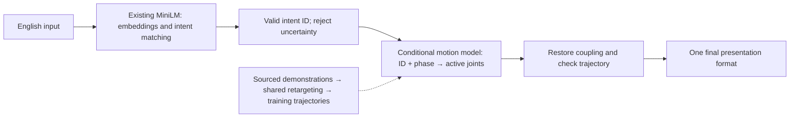

# ME5412: Six-person guide for ten intents and ten learned motions

[中文](ten-intent-learning-guide.md) · **English** · [Documentation index](README.md)

The next-stage goal is English input → one of ten fixed intents selected with an existing free model → robot trajectory generated by our trained motion model. Teams develop in parallel on task branches, then choose one primary presentation format, such as a local demo, website, or video. Online site rebuilding is deferred. The deadline is 2026-11-03. This is a plan, not completed work. Choose the ten meanings according to available demonstrations.

## 1. Shared system structure

Intent IDs are the ten shared meaning identifiers, using the existing `action_id` field. Paraphrases with the same meaning use the same motion condition; gratitude paraphrases enter `THANK_YOU`. Motion generation no longer varies with the original sentence embedding.

Reuse `sentence-transformers/all-MiniLM-L6-v2` first. It produces embeddings; catalog descriptions, aliases, cosine similarity, and rejection thresholds implement ten-class selection. It is not already a trained ten-class classifier. Local use needs no paid inference API. Choose thresholds on new development data before independent testing.

Start motion learning with conditional primitives: intent ID, normalized phase, and bounded duration → active-joint trajectories. Adapt the existing RBF ridge approach from text conditioning to fixed ID conditioning. Independent evidence should determine whether a more complex model is useful. The current upper-body design has 26 active coordinates reconstructed to 53 including coupled joints. Changes in robot degrees of freedom require synchronized interfaces/checks.

Shared IK/retargeting can convert human demonstrations to robot targets across all intents, reducing expression-by-expression authored poses. A model cannot invent its own training demonstrations. Three authored trajectories provide an engineering starting point; new real motion supervision is still absent.

## 2. Three pairs, each owning implementation and tests

These are proposed role assignments, not assignments to named teammates. The scope is ten fixed expressions for healthcare communication, without claiming full sign-language translation or clinical validation.

| Pair | Individual responsibilities | Shared deliverables and acceptance |
|---|---|---|
| 1: text intent understanding | Person 1 implements a keyword baseline and organizes expressions, paraphrases, and negatives. Person 2 integrates MiniLM/a semantic model for paraphrases and rejection. | A shared valid-ID/rejection interface, development data, evaluation scripts, and a baseline/model comparison recording confusion, false rejection, and out-of-library wrong selection. |
| 2: demonstrations to robot | Person 3 extracts and cleans hand/arm demonstrations and records sources, coordinates, timing, and missing data. Person 4 implements robot-joint mapping, retargeting, and constraint checks. | Sourced, reproducible trajectories and processing scripts. Jointly inspect whether handshape, palm orientation, position, and movement preserve meaning; document robot limits and lack of user validation. |
| 3: learned motion | Person 5 trains an intent-ID-conditioned motion generator and manages splits, training, and model versions. Person 6 implements inference, execution integration, transitions, smoothing, and the direct-demonstration playback comparison. | Runnable training/generation, independent tests, and playback comparisons. Both help with training, debugging, and failure analysis, balancing actual workload. |

Everyone owns real implementation and testing. UI, report, slides, integration, reproduction, and the final demo are shared across the team; no person is assigned only presentation work. Name a coordinator for each integration round. A teammate who did not tune the corresponding component runs its frozen independent test; do not tune on those results.

## 3. Freeze interfaces before separate iterations

Keep language outputs: `status`, `action_id`, `reason_code`, `method`, `latency_ms`. With `execute`, the ID must belong to the ten-class registry; `clarify`, `unsupported`, and `error` have null ID. Historical `execute` means selection only; robot presentation has a separate check gate.

Suggested new motion entry: `generate_for_action(action_id, duration_scale, model_version)`. It is proposed, not implemented. A validated ID drives outputs containing `timestamps_s[T]`, `joint_names[J]`, `positions[T,J]`, model version, metrics, and acceptance. Joint angles are radians.

Fix this existing integration issue: v1 `learned_motion.generate(text)` performs exact matching again. A paraphrase accepted by MiniLM can therefore be rejected by motion generation. The new entry must accept a valid ID directly instead of rematching the original text.

Before starting, all three pairs agree on ten intent IDs/meanings, joint names/order, angle units, timestamps/sampling conventions, and one readable example motion. Pair 1 can then develop with text examples, pair 2 with demonstrations/retargeting, and pair 3 with the example motion for training/inference plumbing. Label placeholders and examples; they are not completed training evidence. Final training still depends on valid trajectories from pair 2, and end-to-end validation requires aligned versions from all pairs. Parallel work does not remove dependencies. All pairs approve shared catalog/interface changes and appoint a coordinator for that round.

## 4. Reuse and organize current code

| Location | Next-stage work |
|---|---|
| `language.py`, `config/embedding.json` | Reuse real local MiniLM; check shared guards against new meanings; version configuration. |
| `data/catalog.json`, `contracts/interfaces.json` | Synchronize ten classes, IDs, and interface documentation. |
| `motion.py`, `inspection.py`, render/export scripts | Remove fixed-three `ACTION_IDS` assumptions; synchronize screenshot schedules. |
| `learned_motion.py`, training script | Add a separate version and ID-conditioned generation. |
| `learning_api.py`, `server.py`, `pipeline.py` | Integrate ID → new model, with explicit rejection/failure. |
| `web/`, `project_overview.py` | Use shared catalog; update fixed-three text/material registrations after implementation. |
| `website/dist/` | Retain existing source; export/publish only if the final format is a static website. |

Converge on one local service, one selection API, one motion-generation API, and one primary presentation format. Preserve the existing LLM comparison as historical evidence, outside this development main line. Keep v1 and old results; train in new versions. If selected, a static website displays pregenerated outputs; live inference remains local.

## 5. Data and evaluation completion criteria

Choose ten meanings from obtainable demonstrations the robot can express reasonably. Seek multiple independent performances per class. If only one exists, explicitly limit conclusions to reconstruction. Frame counts, time scaling, and same-source augmentation are not independent performances.

Pair 1 jointly designs text evaluation; persons 1/2 modify using development data only. A designated cross-reviewer from another pair freezes and runs the final text test. Report per-class correct selections, false rejection, confusion, out-of-library wrong selection, and runtime errors. Similarity is not probability.

Split motion by complete demonstration/source; variants of one demonstration remain together. Odd/even-frame error is a fit diagnostic only. Check generated limits, coupling, velocity, available collision geometry, hand positions/palm orientation, and qualitatively compare sources.

Pair 3 jointly compares the learned model with direct interpolation/playback of the same intent under matching inputs and checks, examining trajectory error, constraints, smoothness, and transitions. Establish whether learning provides a benefit; report no benefit honestly rather than inventing novelty or performance improvements. Ten-ID generation covers known meanings; it does not demonstrate an eleventh unseen meaning.

No ASL-user review currently exists. Describe the final scope as “ten-class intent recognition and robot signing candidate-motion generation.” Teammate checks of labels/sources do not validate ASL comprehensibility.

On selection rejection, generation failure, failed trajectory checks, or unavailable model, clear old motion and show the current result. Label pregenerated video with model version/input conditions and distinguish it from live output.

## 6. Milestones to November 3

| Dates in 2026 | Shared target |
|---|---|
| Oct 9–12 | Freeze interfaces; acquire first two classes and actual motion data; run text → ID → learned trajectory → robot display. |
| Oct 13–20 | Obtain/process remaining classes incrementally; train/integrate batches with data/config/model versions. |
| Oct 21–25 | Target full ten-class flow; freeze a candidate and independently test language, motion, and system. |
| Oct 26–28 | Fix/recheck findings; complete the selected presentation format after model stabilization. |
| Oct 29–Nov 2 | Presentation, group rehearsal, second-machine reproduction, offline backup, submission preparation. |
| Nov 3 | Submit according to course instructions. |

These are suggested dates, not a completion guarantee. If data or a two-class flow is missing on Oct 12, immediately revise sources/scope; writing a model architecture does not establish feasibility. All pairs connect interfaces with an example motion in the first round and continuously accept new versions. Both members of pair 3 own learning/execution implementation.

Each delivery records changes, inputs/outputs, version, commands, actual results, failures, and what the next person needs. Discuss shared-interface changes with the round's coordinator and affected owners across all pairs first.

## 7. Branch/PR collaboration

Create task branches from current `master`, commit/push there, and open PRs targeting `master`. The round's coordinator organizes review/validation; an authorized maintainer merges under the team's agreement. Merge each acceptable milestone, then start subsequent tasks from updated mainline; do not wait until the final day to integrate.

See [GitHub collaboration](github-collaboration.en.md) for commands, Desktop, conflicts, and merge order.

## Evidence and entry points

Source-review baseline: `3da7d842f09d8dffe812d436a619679335c88f76`. No training/simulation was rerun for this guide.

- [MiniLM model card](https://huggingface.co/sentence-transformers/all-MiniLM-L6-v2): embedding purpose and Apache-2.0 license.
- [Selection source](https://github.com/kimzclandi/me5412-sign-robot/blob/3da7d842f09d8dffe812d436a619679335c88f76/src/sign_robot/language.py).
- [Learning source](https://github.com/kimzclandi/me5412-sign-robot/blob/3da7d842f09d8dffe812d436a619679335c88f76/src/sign_robot/learned_motion.py).
- [Corpus boundary](语料规模与模型升级.en.md): How2Sign is still a text index; motion supervision is absent.
