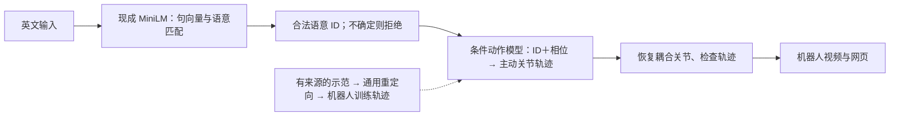

# ME5412：十个语意与十种学习动作的六人分工指南

**中文** · [English](ten-intent-learning-guide.en.md) · [说明目录](README.md)

本轮目标：英文输入经现成免费模型识别为十个固定语意之一，再由我们训练的动作模型生成对应机器人轨迹，最后通过视频和网页展示。截止日期为 2026 年 11 月 3 日。本文是下一阶段实施指南，任务尚未完成，十个语意的具体名单需要按可获得的动作示范确定。

**一、共同采用的系统结构**

语意 ID 是十组共同约定的含义编号，代码中沿用 `action_id` 字段。不同说法只要含义相同，就进入同一动作条件。例如感谢的不同英文改写均进入 `THANK_YOU`，动作生成端不再根据原始英文句向量改变动作。

语言端优先复用仓库已有的 `sentence-transformers/all-MiniLM-L6-v2`。该模型输出句向量，我们通过目录描述、别名、余弦相似度和拒绝阈值完成十类选择；它本身不是已经训练好的十类分类器。模型在本地运行，无需付费推理 API。阈值在新开发数据上确定，最后交独立测试。

动作端先做条件动作基元学习：输入语意 ID、归一化相位和受限时长，输出主动关节轨迹。优先以现有 RBF 岭回归为起点，把原始文字条件改成固定 ID 条件；是否采用更复杂模型，由独立结果决定。当前上肢方案使用 26 个主动坐标，重建成含耦合关节的 53 坐标。若后续改机器人自由度，需要同步接口和验收方式。

通用 IK/重定向仍可以用于将真人示范转换为机器人训练目标；这套工具由全部语意共用。目标是减少逐个表达手写目标姿态。训练示范不能由模型凭空补出。现有三条自编轨迹可作为工程起点，新增真实动作监督尚未接入。

**二、六人分工：语言两人、动作两人、集成展示两人**

| 人员 | 主责 | 输入 | 交付与验收 |
|---|---|---|---|
| 1：语意与文本数据 | 和动作组确定十种含义，整理英文表达、同义改写及混淆反例 | 表达来源、现有 `data/catalog.json` | 十类目录、开发数据、标签争议记录；每个 ID 的含义和不支持范围清楚 |
| 2：免费模型与语意匹配 | 复用 MiniLM，优化目录匹配和拒绝处理 | 第 1 人的目录与开发样例 | 统一选择接口、模型/配置版本、开发结果；库外输入不被强迫分入十类 |
| 3：动作数据与机器人映射 | 找到实际可使用的示范，统一坐标和时间格式，建立共用重定向工具 | 十类含义、真人姿态/动作、机器人模型 | 有来源的训练轨迹、数据清单、几何检查；区分实测姿态与工程近似 |
| 4：条件动作学习 | 使用第 3 人的轨迹，训练 ID 条件动作模型，重建耦合并检查输出 | 训练数据、冻结协议、机器人约束 | 新版权重、生成接口、拟合和独立评价结果；推理使用权重生成轨迹 |
| 5：公共接口、集成与独立评价 | 管理注册与版本，维护独立测试，检查完整流程和第二台电脑复现 | 两组冻结版本和明确依赖 | 一个可运行版本、独立原始结果、失败清单；语意识别和动作质量分开报告 |
| 6：机器人视频、网页与汇报 | 用集成接口制作视角、视频、网页、离线备份与演示 | 第 5 人接入的版本、已检查轨迹 | 十种表达的展示入口、同步的视频与模型版本、离线演示、汇报材料 |

十类目标下，动作数据和学习比复用句向量模型更重。第 1 人完成目录后，继续帮助动作组整理示范与配对记录；第 2 人接口稳定后，继续做语言测试和联调。最后两人从第一天参与。

**三、先固定接口，再分别迭代**

语意组输出保留现有结构：`status`、`action_id`、`reason_code`、`method`、`latency_ms`。`status` 为 `execute` 时，`action_id` 必须在十类注册表中；`clarify`、`unsupported`、`error` 时编号为空。这里的 `execute` 沿用历史命名，仅代表选中表达，机器人展示还有单独的检查门槛。

动作组建议增加独立入口：`generate_for_action(action_id, duration_scale, model_version)`。这是建议接口，尚未实现。输入由已校验的语意 ID 驱动，输出包含 `timestamps_s[T]`、`joint_names[J]`、`positions[T,J]`、模型版本、检查指标和接受状态。关节角单位为弧度。

一个必须修正的现有衔接点：v1 的 `learned_motion.generate(text)` 会再次执行 exact 文字匹配。因此 MiniLM 能识别的改写可能在动作端被拒绝。新动作入口应直接接收合法 ID，而不是把原句交给 v1 再匹配一次。

第 5 人先维护统一注册表、格式和版本。第 1 人提出目录内容，第 5 人合并到公共目录；第 2、3、4 人分别维护语言模块、重定向模块和学习模块；第 6 人维护展示。共同文件由负责人协调修改。

**四、当前代码如何复用和整理**

| 位置 | 下一阶段安排 |
|---|---|
| `language.py`、`config/embedding.json` | 复用真实本地 MiniLM；核对公共 guard 对新增表达的影响，记录新配置 |
| `data/catalog.json`、`contracts/interfaces.json` | 同步十类定义、编号和接口说明 |
| `motion.py`、`inspection.py`、渲染/检查导出脚本 | 整理固定三类 `ACTION_IDS` 的依赖；渲染脚本截图时间表也需要同步 |
| `learned_motion.py`、训练脚本 | 新增独立动作学习版本与 ID 条件生成入口 |
| `learning_api.py`、`server.py`、`pipeline.py` | 接入语意 ID 到新模型的完整流程，明确拒绝和失败状态 |
| `web/`、`project_overview.py` | 使用统一目录显示十类能力，更新固定三动作的文字和资料登记 |
| `website/dist/` | 作为最后导出的静态展示；本地模型升级后需同步导出并重新发布 |

项目收敛到一个本地服务、一套语意接口、一套动作生成接口。现有 LLM 对照作为已有实验保留，不占用本轮主线开发。v1 权重与历史结果保留，新训练另建版本。公开静态站可展示预生成结果，实时模型推理仍在本地服务。

**五、数据与测试怎样算完成**

十个语意先从实际可取得、机器人能够较好表达的示范中选择。每类尽量取得多个独立示范；若某类只有一条，明确其评价只能支持有限的重建结论。帧数、时间缩放和同源增强不计为独立表演。

第 5 人维护新的独立文本测试，第 1、2 人使用开发集做修改。报告每类选对、误拒、错分、库外错误选择和运行错误，不能只给总准确率。相似度分数不当作概率。

动作划分按完整示范/来源进行，同一示范的变体放在同一侧。同轨迹奇偶帧误差只作为拟合诊断。每条生成动作检查关节限位、耦合、速度、已有碰撞几何和核心手部位置/掌向，并与来源进行定性比较。

动作模型应与相同语意的直接轨迹插值/回放比较，说明学习带来的实际收益。十类 ID 条件模型的实验范围是已覆盖语意内的生成，不据此声称掌握新的第十一种含义。

目前没有 ASL 使用者评审，因此最终描述采用“十类语意识别与机器人手语候选动作生成”。同学核对文本标签和来源偏差很有用，但不能据此标记 ASL 可理解性已验证。

完整流程遇到语意拒绝、动作生成失败、轨迹检查不通过或模型不可用时，展示应清除旧动作并显示本次结果。预生成视频注明对应模型版本和输入条件，实时生成与历史视频在界面上明确标识。

**六、按验收点推进到 11 月 3 日**

| 时间 | 全组共同目标 |
|---|---|
| 10 月 9–12 日 | 固定接口；确定首批两类及其实际动作数据；先跑通“文字 → ID → 学习轨迹 → 机器人展示” |
| 10 月 13–20 日 | 逐步取得、处理其余类别；分批训练与接入，每次交付含数据、配置和模型版本 |
| 10 月 21–25 日 | 目标为十类完整流程；冻结候选版本，做独立文本、动作和系统测试 |
| 10 月 26–28 日 | 根据发现的问题修复并复核；模型版本稳定后输出完整视频和静态展示 |
| 10 月 29 日–11 月 2 日 | 汇报、整组排练、第二台电脑复现、离线备份，准备提交 |
| 11 月 3 日 | 按课程通知提交 |

日期是建议安排，不是完成保证。10 月 12 日若尚未取得动作数据或跑通两类，应立刻调整数据来源和范围；不能用模型结构已经写好代替动作学习可行性。最后两人在首轮就用现有动作搭通集成与展示，然后持续接入新版。

每人每次交付一份简短记录：本次变更、输入输出、版本、如何运行、实际结果、失败和下一位需要什么。涉及公共接口变更，先同步给第 5 人及上下游负责人。

**七、用分支与 PR 协作**

每人从最新 `master` 建自己的任务分支，提交和推送到自己的分支，然后开 base 为 `master` 的 PR。第 5 人组织上下游审查、验证和合并；完成一个可验收阶段就合入主线，后续任务从更新后的主线再开分支。不要等最后一天才首次集成。

具体命令、GitHub Desktop 操作、冲突处理和合并顺序见 [GitHub 分支协作指南](github-collaboration.md)。

**依据与入口**

代码审阅依据：仓库提交 `3da7d842f09d8dffe812d436a619679335c88f76`，本次没有重新运行训练或仿真。

- [MiniLM 官方模型卡](https://huggingface.co/sentence-transformers/all-MiniLM-L6-v2)：句向量用途与 Apache-2.0 许可。
- [现有语意识别代码](https://github.com/kimzclandi/me5412-sign-robot/blob/3da7d842f09d8dffe812d436a619679335c88f76/src/sign_robot/language.py)。
- [现有轨迹学习代码](https://github.com/kimzclandi/me5412-sign-robot/blob/3da7d842f09d8dffe812d436a619679335c88f76/src/sign_robot/learned_motion.py)。
- [仓库动作数据说明](https://github.com/kimzclandi/me5412-sign-robot/blob/3da7d842f09d8dffe812d436a619679335c88f76/docs/%E8%AF%AD%E6%96%99%E8%A7%84%E6%A8%A1%E4%B8%8E%E6%A8%A1%E5%9E%8B%E5%8D%87%E7%BA%A7.md)：现有 How2Sign 接入仍为文本索引，动作监督尚未接入。

